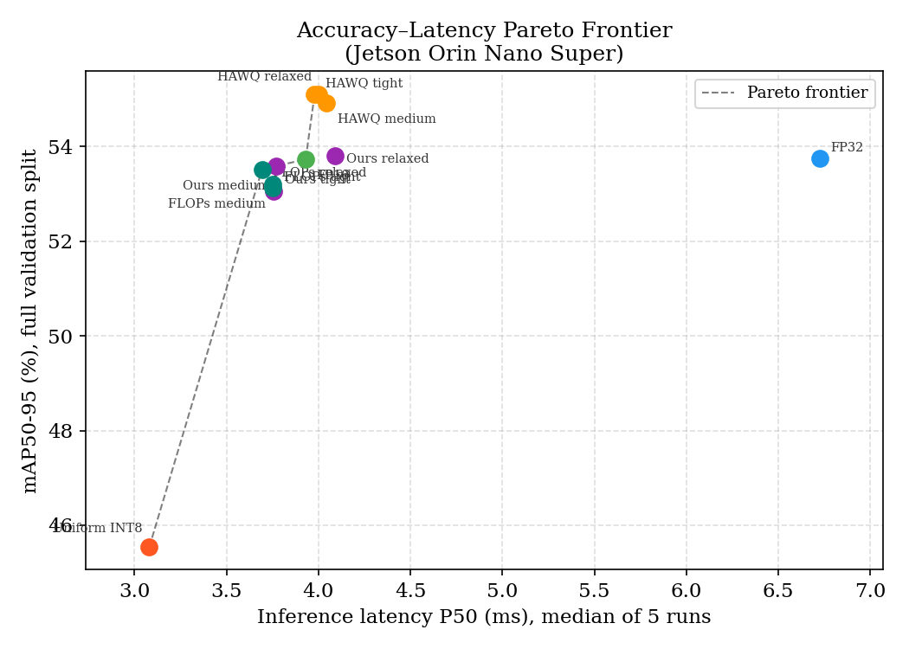

# Latency-Profile-Guided Mixed-Precision Quantization for Real-Time Person Detection on the NVIDIA Jetson Orin Nano Super

Code and results for the paper, accepted at **IEEE ISAIA 2026** (International Conference on Intelligent Systems and Interdisciplinary Applications, Oct. 9–10, 2026).

**Headline result:** recovers 98% of the 8.2 pp mAP50-95 lost by uniform INT8 while running faster than FP16 (3.77 vs 3.93 ms, ~286 FPS) on the Jetson Orin Nano Super.



A latency-profile-guided **mixed-precision quantization** framework for YOLOv8 person detection on the NVIDIA Jetson Orin Nano Super. Instead of uniform INT8 post-training quantization (PTQ), each `Conv2d` layer is assigned INT8 or FP16 using two empirical signals — per-layer on-device latency and per-layer mAP sensitivity to INT8 — combined via a greedy knapsack assignment under a target latency budget.

## Dataset

Trained and evaluated on the **People-Detection (General) 8** dataset — a single-class (`person`) detection dataset of ~20,598 training and ~2,501 validation images at 640×640. See [`quantization/data.yaml`](quantization/data.yaml) for the train/val/test split configuration.

> The dataset itself is **not** included in this repository (see `.gitignore`); point `data.yaml` at your local copy to reproduce.

## Pipeline

The numbered scripts run end to end:

| Step | Script | Purpose |
|------|--------|---------|
| 01 | `01_train_baseline.py` | Fine-tune the YOLOv8n baseline |
| 02 | `02_sensitivity_analysis.py` | Per-layer INT8 mAP sensitivity (one layer at a time) |
| 02b / 02c | `02b_joint_sensitivity.py` / `02c_sensitivity_second_dataset.py` | Additivity check via joint quantization; COCO-person cross-check |
| 03c | `03c_int8_latency_trtexec.py` | Measured per-layer FP16 **and** INT8 latency on the Jetson (`trtexec --dumpProfile`) |
| 04 / 04b | `04_assignment.py` / `04b_assignment_baselines.py` | Greedy assignment under latency budgets; HAWQ-style and FLOPs-proxy baselines |
| 05 | `05_export.py` / `05b_export_mixed.py` | Export engines; exact bijective layer mapping (build aborts on any mismatch) |
| 06 | `06_jetson_profile.sh` | `trtexec` per-layer profiling on Jetson |
| 07 | `07_benchmark_jetson.py` | End-to-end benchmark on Jetson (5 runs, full validation split) |
| 08 | `08_plots.py` / `regenerate_pareto.py` | Figures and Pareto plots |

`03_latency_proxy.py` and `03b_latency_jetson.py` are earlier latency estimators, kept for the FLOPs-proxy ablation and for reference.

## Results

Measured on the Jetson Orin Nano Super (MAXN SUPER). mAP comes from validating each compiled TensorRT engine on the full 2,501-image validation split; latency is the median of 5 `trtexec` runs.

| Condition | mAP50-95 (%) | Latency P50 (ms) | Throughput (fps) |
|---|---|---|---|
| FP32 | 53.75 | 6.72 | 156 |
| FP16 | 53.73 | 3.93 | 278 |
| Uniform INT8 PTQ | 45.54 | 3.08 | 355 |
| Mixed tight (ours) | 53.06 | 3.76 | 287 |
| **Mixed medium (ours)** | **53.59** | **3.77** | **286** |
| Mixed relaxed (ours) | 53.81 | 4.09 | 265 |
| HAWQ-style (tight / medium / relaxed) | 55.1 / 54.9 / 55.1 | 3.98 / 4.04 / 4.00 | 273 / 269 / 272 |
| FLOPs-proxy (tight / medium / relaxed) | 53.1 / 53.2 / 53.5 | 3.75 / 3.75 / 3.69 | 287 / 287 / 292 |

- A single DFL box-regression convolution (`model.22.cv2.0.2`) accounts for ~57% of cumulative INT8 sensitivity, and the top eight layers for ~95%.
- Measured INT8/FP16 per-layer latency ratio: median 0.81 (the datasheet implies 0.5); 22 of 64 convolutions are slower in INT8.
- Every mixed engine realised its requested per-layer precisions exactly (64/64, verified with `IEngineInspector`; reports in `results/engine_inspect_*.json`).

Files under [`quantization/results/`](quantization/results/):

- `results_main.csv`: headline metrics for every engine
- `layer_sensitivity.csv`, `layer_sensitivity_coco.csv`, `joint_sensitivity.csv`, `hessian_traces.csv`: sensitivity measurements
- `layer_latency_measured.csv`, `trtexec_layer_profile.csv`, `trtexec_profile_{fp16,int8}.txt`: per-layer Jetson latency
- `assignment_*.json`, `assignment_summary.csv`: precision maps per method and budget
- `engine_inspect_*.json`: realised per-layer precision of each built engine
- `jetson_env.txt`: device state at benchmark time
- `figures/`: sensitivity/latency heatmaps, assignment map, Pareto plot


## Setup

```bash
pip install -r quantization/requirements.txt
```

## Citation

```bibtex
@inproceedings{ferreira2026latency,
  author    = {Tyler Ferreira},
  title     = {Latency-Profile-Guided Mixed-Precision Quantization for Real-Time Person Detection on the {NVIDIA} {Jetson} {Orin} {Nano} {Super}},
  booktitle = {Proc. IEEE International Conference on Intelligent Systems and Interdisciplinary Applications (ISAIA)},
  year      = {2026}
}
```

## License

MIT — see [`quantization/LICENSE`](quantization/LICENSE).
